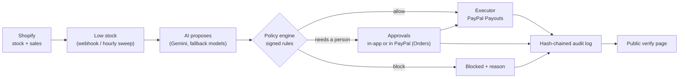

# GuardBuy

**An AI restocking agent for Shopify that can't overspend.** The AI proposes what to reorder. A deterministic policy engine, running rules the merchant signed, decides. PayPal pays the supplier. Every step is written to a hash-chained audit log that anyone can verify.

Built for the PayPal AI Hackathon (Devpost, 2026). MIT licensed.

---

## Why

Small Shopify merchants reorder stock by hand: watch inventory, guess quantities, email the supplier, pay. AI agents can do this, but nobody should hand an LLM their PayPal account. A supplier's message can carry a prompt injection, an inflated price, or a changed payout address, and the model may go along with it.

GuardBuy's answer is to keep the AI away from the decision:

- **The AI only proposes.** It reads stock, sales speed and supplier offers, and suggests a purchase with its reasoning.
- **Signed rules decide.** A plain TypeScript policy engine checks every proposal against limits the merchant signed. The AI can't change them, and its output is treated as untrusted.
- **One executor moves money**, and only after the rules allow it. It re-checks the rules at the moment of payment.
- **Everything is logged** in an append-only, hash-chained audit log. A public page lets anyone check a PayPal payment against it.

## How it works



1. **Trigger.** Shopify's `inventory_levels/update` and `orders/create` webhooks keep stock and daily sales current. An hourly job also sweeps every managed product, so a missed webhook never means a missed restock.
2. **Proposal.** When a switched-on product drops below the merchant's restock point (days of stock left), the AI picks a supplier and quantity from the suppliers the merchant linked, with its reasoning. The model that answered is recorded.
3. **Decision.** The policy engine runs every rule. The strictest result wins: `allow`, `approval` (a person decides) or `block`.
4. **Payment.**
   - Allowed purchases are paid by PayPal Payout to the supplier's PayPal email on file.
   - Purchases that need a person wait in **Approvals**. The merchant approves in GuardBuy, or in PayPal itself through a PayPal order with the supplier as payee.
   - At payment time the rules are checked again against fresh numbers.
5. **Reconciliation.** Visiting Activity or Approvals checks existing supplier payouts with PayPal and confirms transaction IDs through the Agent Toolkit. Checks append status evidence without sending payments. The refresh button and its polling skip the Approvals page's existing order-capture sweep; a normal Approvals visit retains that sweep. No scheduled payment or stock job is enabled.

   Payout checks run at most once per minute per shop, in rotating groups of five. Page loads wait up to 1.5 seconds, then show progress while the shared check continues; failures preserve the last recorded status. Confirmed payouts remain eligible for checks so later returns/refunds can be discovered. Checks only start while the app is used, and transaction-search confirmation can lag. The throttle and concurrent-request coordination are in memory for the current single app process: restarting resets them. Before deploying multiple workers/replicas, replace this coordination with a database-backed lease and atomic status deduplication. The independent audit checkpoint workflow remains unchanged.

### The rules

| Rule | What it does |
| --- | --- |
| Product switched on / supplier linked / supplier approved | Only products and suppliers the merchant chose, ever |
| PayPal email on file | The AI never chooses who gets paid |
| Price cap | An optional hard maximum price per product |
| Price you accepted | A price more than your tolerance (default $0.50 per unit) above the one you entered or last approved → a person approves once, and that becomes the new accepted price. Small automatic increases can't add up |
| Quantity limit, order size vs your history | No orders many times larger than usual; more than 1.5× what you usually buy of a product → a person confirms |
| Split orders | Purchases of the same product from the same supplier within 24 h count together against the approval limit |
| New or lookalike supplier | The first purchase from a supplier added in the last 30 days, or any purchase from one whose name imitates another supplier's → a person confirms |
| Purchases per 24 h, weekly spending cap | Limits how often and how much; the weekly cap also counts purchases still waiting for approval |
| Cash floor | Never takes the PayPal balance below a set amount |
| Recent payee change | A supplier's PayPal email changed in the last 14 days → a person confirms |
| "No approval needed" claims | Supplier text claiming pre-approval or urgency → a person confirms |
| Approval limit | Purchases above the limit wait for the merchant |

Rules are signed by a Shopify staff member: their id and the rules' SHA-256 fingerprint are written to the audit log, and every decision records which rule set it used.

### Safety details

- **Append-only audit log, enforced in three places.**
  - *Hash chain:* each entry's hash covers the previous hash, so editing, deleting or reordering any past entry breaks every hash after it. Home and Activity verify the whole chain on load.
  - *Database:* the running app connects as `guardbuy_app`, a role that can read and add audit entries but has no UPDATE, DELETE or TRUNCATE privilege on them. A trigger also rejects edits and deletes from the owner role, unless the transaction explicitly opts in (only check scripts cleaning up throwaway test shops do that). `scripts/check-audit-readonly.ts` proves both.
  - *Outside the database:* historical fingerprints are in `anchors/fingerprints.jsonl`. The independent R2 checkpoint workflow is enabled every six hours. It recomputes database history and checks existing external checkpoints before publishing changes. Bootstrap and an unchanged repeat run passed on 31 October 2026. The app's Home/Activity checks currently verify internal consistency only; they do not establish external verification. See [checkpoint status and setup](anchors/README.md).
- **Re-check at payment.** Approvals expire after 48 hours, and the rules and balance are checked again just before money moves.
- **One payment per decision.** A database lock (`PaymentLock`) and PayPal idempotency keys mean a double click, a second tab or a retry can't pay twice.
- **Approve in PayPal.** Only allow-listed PayPal payer ids can approve (`GUARDBUY_APPROVER_PAYER_IDS`). Cancelled, expired and wrong-payer orders are closed without paying.
- **Kill switch.** `GUARDBUY_PAYMENTS_DISABLED=1` refuses every payout and capture.
- **Least privilege.**
  - Shopify scopes: `read_products`, `read_orders`, `write_inventory`. Write access is only used to reset demo stock.
  - PayPal Agent Toolkit: only the read-only `get_order` and `list_transactions` tools are loaded.
- **Untrusted text stays labelled.** Supplier notes and the AI's explanation are shown as "not verified" and never drive a payment on their own.

## PayPal

| What | How GuardBuy uses it |
| --- | --- |
| **Payouts API** (`/v1/payments/payouts`) | Pays suppliers for purchases the rules allow, or that a staff member approved in GuardBuy |
| **Orders API v2** (`/v2/checkout/orders`) | "Approve in PayPal": an order with the supplier as payee, approved by the merchant in PayPal, then captured |
| **Balances** (`/v1/reporting/balances`) | Cash-floor rule, adjusted for PayPal's reporting lag |
| **Agent Toolkit: `get_order`** | Checks order status on return from PayPal and in the background sweep |
| **Agent Toolkit: `list_transactions`** | Confirms each payout in PayPal's own transaction records |

**Sandbox note.** The demo runs on the PayPal sandbox. One sandbox business account plays both GuardBuy and the merchant, and pays the supplier's sandbox account. Purchases approved in PayPal already come from the merchant's own account. In production, each merchant connects their own PayPal.

## Try it

**Judges:** the private Devpost notes have the demo store link, its password and three steps. On the storefront, the judge console at `/apps/guardbuy` lets you:
- simulate a sale
- watch the agent react
- approve your own purchases
- send a dishonest supplier (16 attack scenarios, easy to hard) against the real AI and rules

Each judge gets their own sandbox, so nothing you do affects anyone else.

**Merchant admin:** Home, Products & suppliers, Suppliers, Rules, Approvals, Activity (audit log) and Protection (rules at work, attack results, public verification settings).

**Public verify page:** `/verify?id=<PayPal payout or order id>` shows whether a payment is on a store's audit log, which signed rules allowed it, and whether the log is intact.

## Run it locally

Requirements:
- Node 22.12+
- [Shopify CLI](https://shopify.dev/docs/apps/tools/cli) and a Shopify Partner account with a development store
- A Postgres database (Neon works)
- A PayPal developer account with sandbox apps
- A Gemini API key (an OpenRouter key is optional, for fallback models)

```bash
git clone https://github.com/M00rish/guardbuy.git
```

```bash
cd guardbuy && npm ci
```

```bash
cp .env.example .env
```

Fill in `.env` (every variable is described there), then apply the database migrations:

```bash
npx prisma migrate deploy
```

Create the app's restricted database role. This makes `DATABASE_URL` in `.env` connect as `guardbuy_app`, which can't change the audit log; `DIRECT_URL` stays the owner, for migrations:

```bash
npx tsx scripts/create-app-role.ts --rotate
```

Start the app. This opens a tunnel and installs it on your dev store:

```bash
npm run dev
```

Optional demo data, with `shopify app dev` running. The CLI prints the GraphiQL URL:
- `scripts/seed-dev-store.ts` creates the demo products and 30 days of test orders. It needs write scopes added temporarily; see the comment at the top of the script.
- `scripts/seed-demo-suppliers.ts` adds the demo suppliers and links them.

Then in the app:
1. Switch on products.
2. Add suppliers with their PayPal emails.
3. Link suppliers to products.
4. Sign your rules.

Home walks you through these steps.

### Checks

Offline and deterministic (they run in CI):

```bash
npx tsx scripts/check-policy.ts
```

```bash
npx tsx scripts/check-scoreboard.ts
```

The other `scripts/check-*.ts` scripts use the database, the PayPal sandbox or the AI: `check-verify`, `check-recheck`, `check-unhappy`, `check-paypal-errors`, `check-approvals`, `check-attacks`, `check-judge`. Read each script's header before running it: some move sandbox money. `check-recheck` and `check-unhappy` turn on the kill switch themselves.

## Deploy

`render.yaml` describes a Render web service:
- **Build:** `npm ci`, `prisma generate`, `react-router build`
- **Start:** `prisma migrate deploy`, then the server
- **Health check:** `/healthz`

Secrets are set in the Render dashboard.

Steps:
1. Set Render's `DATABASE_URL` to the `guardbuy_app` connection string from your `.env` (see *Run it locally*), and `DIRECT_URL` to the owner's direct connection.
2. Set `application_url` in `shopify.app.toml` to the Render URL and `[app_proxy].url` to that URL plus `/proxy`. Keep `write_app_proxy` in the required scopes.
3. Run `npm run deploy` to release the Shopify configuration. Reopen GuardBuy in Shopify admin and approve any requested permission update. This is separate from deploying the web server to Render.
4. The independent audit workflow is enabled for this deployment, with its dedicated credentials stored in GitHub Actions. It connects directly to Neon and R2, never calls Render or payment/stock actions, and does not commit fingerprints to `main`. For a new deployment, follow [checkpoint setup](anchors/README.md) and keep its schedule disabled until setup and bootstrap verification are complete.

The shared demo config disables automatic URL updates during `shopify app dev`. Use a separate app/config for tunnel development so local sessions cannot replace the judge console's hosted destination. After deployment, verify the active Shopify app version points `/apps/guardbuy` to `https://guardbuy.onrender.com/proxy`. Test through the storefront: opening `/proxy` directly without Shopify's signature correctly returns 400.

To reset the demo (stock back to the start, sandbox balance topped up):

```bash
npx tsx scripts/reset-demo.ts
```

## Project layout

```
app/
  lib/agent/       restock loop, AI proposer, executor, approvals, attack tests, payment lock
  lib/policy/      rule schema, policy engine, rule labels, rules form checks
  lib/audit/       hash-chained log, activity feed, public verification
  lib/paypal/      REST client, Agent Toolkit wrapper, reconciliation, orders sweep
  lib/inventory/   sales rates, days of cover, stock trigger
  lib/suppliers/   supplier directory, demo catalog, attack scenarios
  lib/judge/       judge console sandboxes and limits
  lib/jobs/        hourly job, demo reset
  routes/          admin pages (app.*), webhooks, app proxy (judge console), verify page, jobs
prisma/            schema and hand-written migrations
scripts/           checks, seeding, demo reset, sandbox refill
anchors/           published audit-log fingerprints (created by the first hourly run)
```

## Stack

- Shopify React Router app template
- Polaris web components and App Bridge
- Prisma on Neon Postgres
- AI SDK with Gemini, plus OpenRouter free models as fallbacks
- PayPal REST APIs and the PayPal Agent Toolkit
- Render, and GitHub Actions for the hourly job and CI

## License

MIT. See [LICENSE.md](LICENSE.md). Portions are from Shopify's app template (MIT).
