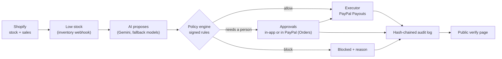

# GuardBuy

**An AI restocking agent for Shopify that can't overspend.** The AI proposes what to reorder. A deterministic policy engine, running rules the merchant signed, decides. PayPal pays the supplier. Every step is written to a hash-chained audit log that anyone can verify.

Built for the PayPal AI Hackathon (Devpost, 2026). MIT licensed.

---

## Why

Small Shopify merchants reorder stock by hand: watch inventory, guess quantities, email the supplier, pay. AI agents can do this, but nobody should hand an LLM their PayPal account. A supplier's message can carry a prompt injection, an inflated price, or a changed payout address, and the model may go along with it.

GuardBuy's answer is to keep the AI away from the decision:

- **The AI only proposes.** It reads stock, sales speed and supplier offers, and suggests a purchase with its reasoning.
- **Signed rules decide.** A plain TypeScript policy engine checks every proposal against limits the merchant signed. The AI can't change them, and its output is treated as untrusted.
- **One executor moves money**, and only after the rules allow it. It re-checks the rules at the moment of payment.
- **Everything is logged** in an append-only, hash-chained audit log. A public page lets anyone check a PayPal payment against it.

## How it works



1. **Trigger.** Shopify's `inventory_levels/update` webhook commits a durable inventory job before responding; `orders/create` keeps daily sales current. A web-process worker reads current stock/sales and handles queued jobs. No scheduled stock sweep is enabled; a webhook that never reaches the app still has no automatic hourly fallback.
2. **Proposal.** When a switched-on product drops below the merchant's restock point (days of stock left), the AI picks a supplier and quantity from the suppliers the merchant linked, with its reasoning. The model that answered is recorded.
3. **Decision.** The policy engine runs every rule. The strictest result wins: `allow`, `approval` (a person decides) or `block`.
4. **Payment.**
   - Allowed purchases are paid by PayPal Payout to the supplier's PayPal email on file.
   - Purchases that need a person wait in **Approvals**. The merchant approves in GuardBuy, or in PayPal itself through a PayPal order with the supplier as payee.
   - At payment time the rules are checked again against fresh numbers.
5. **Reconciliation.** Visiting Activity or Approvals checks existing supplier payouts with PayPal and confirms transaction IDs through the Agent Toolkit. Checks append status evidence without sending payments. The refresh button and its polling skip the Approvals page's existing order-capture sweep; a normal Approvals visit retains that sweep. No scheduled payment or stock job is enabled.

   Payout checks run at most once per minute per shop, in rotating groups of five. Page loads wait up to 1.5 seconds, then show progress while the shared check continues; failures preserve the last recorded status. Confirmed payouts remain eligible for checks so later returns/refunds can be discovered. Checks only start while the app is used, and transaction-search confirmation can lag. The throttle and concurrent-request coordination are in memory for the current single app process: restarting resets them. Before deploying multiple workers/replicas, replace this coordination with a database-backed lease and atomic status deduplication. The independent audit checkpoint workflow remains unchanged.

### The rules

| Rule | What it does |
| --- | --- |
| Product switched on / supplier linked / supplier approved | Only products and suppliers the merchant chose, ever |
| PayPal email on file | The AI never chooses who gets paid |
| Price cap | An optional hard maximum price per product |
| Price you accepted | A price more than your tolerance (default $0.50 per unit) above the one you entered or last approved → a person approves once, and that becomes the new accepted price. Small automatic increases can't add up |
| Quantity limit, order size vs your history | No orders many times larger than usual; more than 1.5× what you usually buy of a product → a person confirms |
| Split orders | Purchases of the same product from the same supplier within 24 h count together against the approval limit |
| New or lookalike supplier | The first purchase from a supplier added in the last 30 days, or any purchase from one whose name imitates another supplier's → a person confirms |
| Purchases per 24 h, weekly spending cap | Limits how often and how much; the weekly cap also counts purchases still waiting for approval |
| Cash floor | Never takes the PayPal balance below a set amount |
| Recent payee change | A supplier's PayPal email changed in the last 14 days → a person confirms |
| "No approval needed" claims | Supplier text claiming pre-approval or urgency → a person confirms |
| Approval limit | Purchases above the limit wait for the merchant |

Rules are signed by a Shopify staff member: their id and the rules' SHA-256 fingerprint are written to the audit log, and every decision records which rule set it used.

### Safety details

- **Durable payment attempts (ISM-134).** Before any Payout, Order creation or capture, GuardBuy appends the chosen route, account fingerprint, request ID and exact request body to the audit chain. No credentials are stored in that snapshot. Unknown outcomes keep the product and committed budget reserved indefinitely; recorded provider-pending payments also retain their budget reservation until an item/capture status settles. A missing transaction-search result never releases money. Known captures can be recovered with a read-only Order lookup after a restart.

  For a missing Payout or Order-creation response, use **Approvals → Resume original payment**. This is an explicit payment action: it may perform the original payment if the first call never reached PayPal. It always reuses the persisted body/account/key, re-checks current safety rules, and cannot select another payment route. Payout duplicate recovery verifies the original batch's sender ID, recipient, amount and currency. Read-only refresh never replays an unknown payment POST; the normal Approvals sweep may still capture a newly approved Order with no prior uncertain capture.

  Retries stop after conservative API-specific windows: 29 days for Payouts and 5 hours for Order creation/capture. A known Order can still be checked read-only afterwards. An expired unknown request, changed funding account or failed replay safety check requires manual provider reconciliation; its reservation remains. Do not create a replacement purchase or edit/delete audit rows to release it. Legacy `payment_failed` entries without positive failure evidence are conservatively held too; historical requests with no recorded evidence cannot be reconstructed automatically. There is no scheduled payment-recovery worker or manual release of uncertain reservations. The inventory worker below recovers restock processing and never automatically replays an uncertain payment POST.

  Payment writers share a renewable database lease for the configured funding account across stores. Audit reservation writes verify lease ownership, and conditional audit inserts prevent route races. Separate product leases coordinate restock proposals. Offline regression checks: `npx tsx scripts/check-payment-attempts.ts`, `npx tsx scripts/check-payment-http.ts`, and `npx tsx scripts/check-paypal-errors.ts`; they use in-memory state or a localhost fake provider and send no real payments.

- **Unpaid approvals stay visible (ISM-135).** Approvals separates staff approval from payment confirmation. A definitively rejected request stays on its card with a reason. **Retry payment** keeps the same purchase, supplier and amount, re-checks current safety rules, and records a new attempt only after confirmed rejection. **Resume original payment** handles an unknown outcome using its saved request and idempotency key; it never changes routes. Provider-pending payments remain visible until confirmation. Refreshing payout status does not submit a retry.

  Staff can cancel an unpaid failed purchase; the cancellation is logged, and the existing decline cooldown applies before the agent proposes it again. Unknown or provider-pending payments cannot be cancelled through this flow. Failed purchases stop accepting retries after the original 48-hour approval window but remain visible for cancellation. Older approvals with no saved request or positive failure evidence require manual PayPal reconciliation and retain their reservation. Approval actions use a database lease plus conditional audit writes across workers. `npx tsx scripts/check-unpaid-approvals.ts` runs offline workflow regressions; `scripts/check-unpaid-approvals-db.ts` additionally tests the actual queue and database coordination against a disposable local Postgres database named `guardbuy_ism135_test`.

- **Durable inventory jobs (ISM-43).** The inventory webhook saves one `RestockJob` per shop/inventory item before acknowledging delivery. Bursts coalesce into generations; a worker can finish only its claimed generation, and later webhooks remain pending. Expired claims resume after a restart. Audit proposals carry a stable job/generation ID, so recovery completes the original proposal/decision rather than generating a replacement. A recorded or uncertain payment is never automatically submitted again by job recovery. Each money-moving action still uses the current signed rules, bound payee/amount, emergency stop and a shared funding-account lease.

  A worker starts with the production web process. It polls the database every five seconds while idle, drains work sequentially in each process, and renews job leases every 20 seconds (120-second expiry). Product and funding leases use the database clock, renew every 15 seconds and expire after 60 seconds; stale workers cannot append new reservations or definitive failures. Queue failures back off up to five minutes; AI proposal failures retain the original generation for a 15-minute retry. New webhooks do not bypass an active retry cooldown. Reads use fresh stock and sales; paused or uninstalled stores do not start new purchases.

  Render free instances can sleep: saved jobs resume when the web process wakes, not while it is stopped. Polling can keep Neon awake while the web service is running. Set `GUARDBUY_RESTOCK_WORKER=off` to pause queue processing without deleting work; local development opts in with `on`. `GUARDBUY_PAYMENTS_DISABLED=1` still blocks money movement. The optional `/jobs/hourly` sweep now enqueues durable checks, but no scheduler is enabled by this change.

  Deployment requires `prisma migrate deploy` for `RestockJob`. The migration grants the existing `guardbuy_app` role read/write access to this mutable coordination table; the audit log's append-only restrictions stay in place. No new credentials, Shopify scopes or external worker service are needed. Real multi-process regressions run via `npx tsx scripts/check-payment-workers.ts` against the disposable local `guardbuy_ism43_test` database: route races, approval/decline, forced lease loss, process death, callback/sweep capture, shared funding, coalesced jobs and startup recovery. Provider/AI/Shopify responses are simulated; the executor, queue, audit writes and leases use the actual code and Postgres.

- **Append-only audit log, enforced in three places.**
  - *Hash chain:* each entry's hash covers the previous hash, so editing, deleting or reordering any past entry breaks every hash after it. Home and Activity verify the whole chain on load.
  - *Database:* the running app connects as `guardbuy_app`, a role that can read and add audit entries but has no UPDATE, DELETE or TRUNCATE privilege on them. A trigger also rejects edits and deletes from the owner role, unless the transaction explicitly opts in (only check scripts cleaning up throwaway test shops do that). `scripts/check-audit-readonly.ts` proves both.
  - *Outside the database:* historical fingerprints are in `anchors/fingerprints.jsonl`. The independent R2 checkpoint workflow is enabled every six hours. It recomputes database history and checks existing external checkpoints before publishing changes. Bootstrap and an unchanged repeat run passed on 31 October 2026. The app's Home/Activity checks currently verify internal consistency only; they do not establish external verification. See [checkpoint status and setup](anchors/README.md).
- **Re-check at payment.** Approvals expire after 48 hours, and the rules and balance are checked again just before money moves.
- **One payment per decision.** A database lock (`PaymentLock`) and PayPal idempotency keys mean a double click, a second tab or a retry can't pay twice.
- **Approve in PayPal.** Only merchant payer IDs explicitly bound to the store and configured client ID can fund capture (`GUARDBUY_PAYPAL_STORES`). Missing and wrong payers are refused. A fresh wrong-payer order can be closed without a capture; an uncertain earlier capture stays reserved for reconciliation. The obsolete global `GUARDBUY_APPROVER_PAYER_IDS` is ignored.
- **Kill switch.** `GUARDBUY_PAYMENTS_DISABLED=1` refuses every payout and capture.
- **Least privilege.**
  - Shopify scopes: `read_products`, `read_orders`, `read_inventory`, `read_locations`, `write_inventory`, `write_app_proxy`. Inventory writes record physical delivery receipts and reset demo stock.
  - PayPal Agent Toolkit: only the read-only `get_order` and `list_transactions` tools are loaded.
- **Untrusted text stays labelled.** Supplier notes and the AI's explanation are shown as "not verified" and never drive a payment on their own.

## PayPal

| What | How GuardBuy uses it |
| --- | --- |
| **Payouts API** (`/v1/payments/payouts`) | Pays suppliers for purchases the rules allow, or that a staff member approved in GuardBuy |
| **Orders API v2** (`/v2/checkout/orders`) | "Approve in PayPal": an order with the supplier as payee, approved by the merchant in PayPal, then captured |
| **Balances** (`/v1/reporting/balances`) | Cash-floor rule, adjusted for PayPal's reporting lag |
| **Agent Toolkit: `get_order`** | Checks order status on return from PayPal and in the background sweep |
| **Agent Toolkit: `list_transactions`** | Confirms each payout in PayPal's own transaction records |

**Sandbox account ownership (ISM-37).** This server reads one global `PAYPAL_CLIENT_ID` / `PAYPAL_CLIENT_SECRET`. Automatic and in-app-approved Payouts spend that sandbox business account's balance. PayPal Orders pay the recorded supplier from the sandbox account whose payer approves checkout; it must be one of the merchant payer IDs explicitly bound to that shop. These can be different accounts. Supplier credentials are used only by test/refill scripts. There is no per-store PayPal credential storage or onboarding.

Before enabling payments, set `GUARDBUY_PAYPAL_STORES` as server-side JSON, for example:

```json
{"your-store.myshopify.com":{"clientId":"your-sandbox-client-id","payerIds":["YOURMERCHANTPAYERID"]}}
```

Use the exact Shopify shop domain, the configured client ID and the intended merchant's sandbox payer ID (not its email or the supplier's payer). A shop absent from this mapping cannot submit Payouts, create Orders or capture them. Empty/malformed lists, missing payer identity and another shop's payer fail closed. Bind only shops whose owner has deliberately authorized this account; a configuration entry is operator configuration, not a merchant consent/onboarding product. Startup validates mappings before starting the restock worker. An enabled public demo must name a bound demo store. Account/client changes require rebinding and manual reconciliation of saved attempts from the old account. Coordinate real credential changes with ISM-133; this PR does not rotate any credentials.

REST and Agent Toolkit both require the exact `https://api-m.sandbox.paypal.com` origin. Live and alternate API origins are rejected, including with the public judge dashboard enabled. This app does not enable live payments. Before real merchant use, establish the supported PayPal ownership, onboarding, merchant consent and production permissions model separately.

Deployment: add the explicit mapping before starting this version with payments enabled. If it is not ready, set `GUARDBUY_PAYMENTS_DISABLED=1` to run a sandbox server that displays history while refusing payment writes. There is no permissive development payer exception. Offline HTTP tests alone opt into a loopback fake REST API with both `NODE_ENV=test` and `GUARDBUY_PAYPAL_TEST_API=1`; the real Toolkit refuses that different environment and integration tests replace its reads with a local adapter. Do not set the test flag in deployment. Existing read-only settlement recovery continues to record already completed payments, even when a mapping is later removed; removing authorization never proves an earlier attempt unpaid.

Checks: `npx tsx scripts/check-paypal-binding.ts` covers store/account binding and startup configuration without provider I/O. The multi-process/Postgres suite also exercises the actual executor with a simulated provider to prove refused identities send zero capture requests.

Start production with `npm run start`. Its logger preload keeps request methods, paths and response status while omitting every query parameter, including Shopify session tokens and PayPal return identities. Do not bypass the preload by invoking `react-router-serve` directly. `node scripts/check-access-logs.mjs` exercises the logger with real local HTTP requests. This does not remove historical deployment logs; review prior exposure and credential rotation separately under ISM-133.

## Try it

**Judges:** open the demo store in one tab and `/apps/guardbuy` in another. The public dashboard is read-only and shows actual managed stock, today’s test-order count (UTC), recorded restock decisions, and supplier payment outcomes. Place a test checkout order in the storefront and watch the stock change. All visitors see the same store; this is no longer a per-judge simulated sandbox.

**Enable the dashboard:** explicitly set `GUARDBUY_PUBLIC_DEMO_ENABLED=true` and `GUARDBUY_DEMO_STORE` to the intended demo shop domain. It is disabled by default and refuses to open if PayPal’s configured API base is not the sandbox. The delivery feature requires `read_inventory`, `read_locations` and `write_inventory` in addition to the existing app scopes; release the updated Shopify configuration and approve permissions. No database migration is required. Opening the page is consent to expose only aggregate activity for that store: no customer records, supplier emails, payment IDs, approval URLs, AI reasoning, staff identities, or raw provider errors are returned.

The page polls every 15 seconds while visible, with a shared 15-second server cache. This polling can keep Render and Neon awake while judges watch. Test-order counts come from Shopify (only `test:true` orders created today UTC; cancelled test orders still count as orders placed). Stock shows up to 50 managed variants. Missing data is labelled unavailable rather than zero. Restock/payment totals cover recorded non-simulation history, not just today. Stock change arrows are observations in the current browser tab, not guaranteed attribution to a particular customer order.

Public requests never send payments, capture orders, reconcile PayPal or change inventory. The old proxy action API returns 405. Payment outcomes are the last known audit evidence; keep the merchant Activity/Approvals page available and refresh statuses there. A batch-level payout SUCCESS alone is not shown as recipient success. A supplier payment does not replenish Shopify stock until goods are recorded as received.

**Prepare and manually test the demo:**

1. Configure Shopify test checkout (Bogus Gateway or a payment provider’s test mode) on the dedicated demo store, and give judges test checkout instructions. Never ask them to use a real card. Verify that a completed checkout is marked as a test order.
2. In GuardBuy, manage a published product, link its supplier and sandbox payee, sign appropriate rules, and check the sales rate/reorder threshold. Ensure there is no unresolved restock already blocking another proposal.
3. Pause the agent while preparing stock. Use Shopify Admin’s inventory adjustment to set available stock just above the reorder threshold, then resume the agent. Buy enough units in test checkout to cross the threshold. The existing reset script sets coffee directly to low stock and also tops up the PayPal sandbox balance: do not use it as a blind reset for this purchase-triggered scenario.
4. Confirm the order count increases and stock decreases on the public dashboard. Allow time for Shopify webhooks, order indexing and AI processing. The timeline should show a proposal and policy decision. Outcomes can require merchant review; do not weaken rules merely to guarantee automatic payment.
5. If review is required, approve from the merchant app. Refresh payout status in Activity and confirm the public outcome updates on its next poll. Compare with PayPal sandbox. Check that no second payment appears when the public page is refreshed.
6. Verify a POST to the public proxy API returns 405, a non-enabled store cannot access either route, and dashboard JSON contains no personal data or payment credentials. Test stock/order API errors: show unavailable or stale data, never an invented zero.
7. Reset stock only through Shopify Admin or the authenticated backend reset tooling. Never delete production audit history to rerun a demo. Use the isolated environment planned in ISM-137 for repeatable fixture resets.

**Optional attack tests:** enabled demo-store staff can open Rules & Approvals → Rules → Open private demo attack tests (`/app/attack-tests`). Tests use an authenticated staff-specific record namespace, not the real shop’s inventory or orders. The real AI attack and explicitly simulated “AI fooled” options remain separate, and neither pays suppliers. Refresh results after the background AI run finishes. These tests may consume AI API usage.

**Merchant admin:** Home, Products & suppliers (Products and Suppliers tabs), Rules & Approvals (Approvals and Rules tabs), Deliveries, Activity (audit log and public verification settings), and Alerts.

**Public verify page:** `/verify?id=<PayPal payout or order id>` shows whether a payment is on a store's audit log, which signed rules allowed it, and whether the log is intact.

### Receiving supplier deliveries

Approval submits a payment; it does not increase stock. Open **Deliveries** in the merchant app to see ordered, received and outstanding quantities. Successful payment must be recorded before starting a receipt. Pick the actual receiving location and enter the units physically received. Partial receipts are supported; over-receipts and stale submissions are rejected. Pending receipt attempts can be retried using **Confirm existing receipt**. No public route can receive deliveries.

A receipt appends a durable intent to the audit chain, calls Shopify `inventoryAdjustQuantities` with the same UUID idempotency key on every retry, then records completion. An atomic database audit condition prevents concurrent reservations or duplicate completion entries even if the outer coordination lease expires. If the API response or final audit write is lost, the pending intent remains and blocks a second receipt. [Shopify retains idempotency keys for 24 hours](https://shopify.dev/docs/apps/build/apis/graphql-admin/implementing-idempotency); after 23 hours an ambiguous receipt is refused and requires manual reconciliation against Shopify inventory history. Do not adjust inventory manually and then retry the same receipt.

Incoming quantity is GuardBuy's outstanding order total, not Shopify's native inventory-transfer `incoming` state. Available stock stays unchanged until a receipt succeeds. Failed/refunded payments do not erase already received goods. Outstanding variant orders no longer expire after three days; they keep duplicate restocks blocked until received. Legacy audit entries without a variant ID retain the old cooldown and cannot be received through this screen.

Existing purchases with a variant ID and no recorded receipts appear outstanding. Review them before receiving: goods that were already added manually to Shopify must not be added again through a new receipt. Shipping, cancellations and administrative reconciliation of historical deliveries are outside this first receipt flow.

For deployment, release the updated `shopify.app.toml` scopes (`read_inventory`, `read_locations`, existing `write_inventory`) and approve Shopify's permission update. No database migration or new secret is needed. Manually test a paid order with a partial receipt: available stock rises only by the received amount, remaining incoming decreases, repeating the same submission adds nothing, and the final receipt closes the order. Keep payment approval and inventory receipt as separate actions.

## Run it locally

Requirements:
- Node 22.12+
- [Shopify CLI](https://shopify.dev/docs/apps/tools/cli) and a Shopify Partner account with a development store
- A Postgres database (Neon works)
- A PayPal developer account with sandbox apps
- A Gemini API key (an OpenRouter key is optional, for fallback models)

```bash
git clone https://github.com/M00rish/guardbuy.git
```

```bash
cd guardbuy && npm ci
```

```bash
cp .env.example .env
```

Fill in `.env` (every variable is described there), then apply the database migrations:

```bash
npx prisma migrate deploy
```

Create the app's restricted database role. This makes `DATABASE_URL` in `.env` connect as `guardbuy_app`, which can't change the audit log; `DIRECT_URL` stays the owner, for migrations:

```bash
npx tsx scripts/create-app-role.ts --rotate
```

Start the app. This opens a tunnel and installs it on your dev store:

```bash
npm run dev
```

Optional demo data, with `shopify app dev` running. The CLI prints the GraphiQL URL:
- `scripts/seed-dev-store.ts` creates the demo products and 30 days of test orders. It needs write scopes added temporarily; see the comment at the top of the script.
- `scripts/seed-demo-suppliers.ts` adds the demo suppliers and links them.

Then in the app:
1. Switch on products.
2. Add suppliers with their PayPal emails.
3. Link suppliers to products.
4. Sign your rules.

Home walks you through these steps.

### Checks

Offline and deterministic (they run in CI):

```bash
npx tsx scripts/check-policy.ts
```

```bash
npx tsx scripts/check-scoreboard.ts
```

The other `scripts/check-*.ts` scripts use the database, the PayPal sandbox or the AI: `check-verify`, `check-recheck`, `check-unhappy`, `check-paypal-errors`, `check-approvals`, `check-attacks`, `check-judge`. Read each script's header before running it: some move sandbox money. `check-recheck` and `check-unhappy` turn on the kill switch themselves.

## Deploy

`render.yaml` describes a Render web service:
- **Build:** `npm ci`, `prisma generate`, `react-router build`
- **Start:** `prisma migrate deploy`, then the server
- **Health check:** `/healthz`

Secrets are set in the Render dashboard.

Steps:
1. Set Render's `DATABASE_URL` to the `guardbuy_app` connection string from your `.env` (see *Run it locally*), and `DIRECT_URL` to the owner's direct connection.
2. Set `application_url` in `shopify.app.toml` to the Render URL and `[app_proxy].url` to that URL plus `/proxy`. Keep `write_app_proxy` in the required scopes.
3. Run `npm run deploy` to release the Shopify configuration. Reopen GuardBuy in Shopify admin and approve any requested permission update. This is separate from deploying the web server to Render.
4. The independent audit workflow is enabled for this deployment, with its dedicated credentials stored in GitHub Actions. It connects directly to Neon and R2, never calls Render or payment/stock actions, and does not commit fingerprints to `main`. For a new deployment, follow [checkpoint setup](anchors/README.md) and keep its schedule disabled until setup and bootstrap verification are complete.

The shared demo config disables automatic URL updates during `shopify app dev`. Use a separate app/config for tunnel development so local sessions cannot replace the public dashboard’s hosted destination. After deployment, verify the active Shopify app version points `/apps/guardbuy` to `https://guardbuy.onrender.com/proxy`. Test through the storefront: opening `/proxy` directly without Shopify's signature correctly returns 400.

To reset the demo (stock back to the start, sandbox balance topped up):

```bash
npx tsx scripts/reset-demo.ts
```

## Project layout

```
app/
  lib/agent/       restock loop, AI proposer, executor, approvals, attack tests, payment lock
  lib/policy/      rule schema, policy engine, rule labels, rules form checks
  lib/audit/       hash-chained log, activity feed, public verification
  lib/paypal/      REST client, Agent Toolkit wrapper, reconciliation, orders sweep
  lib/inventory/   sales rates, days of cover, stock trigger
  lib/suppliers/   supplier directory, demo catalog, attack scenarios
  lib/judge/       judge console sandboxes and limits
  lib/jobs/        hourly job, demo reset
  routes/          admin pages (app.*), webhooks, app proxy (read-only demo dashboard), verify page, jobs
prisma/            schema and hand-written migrations
scripts/           checks, seeding, demo reset, sandbox refill
anchors/           published audit-log fingerprints (created by the first hourly run)
```

## Stack

- Shopify React Router app template
- Polaris web components and App Bridge
- Prisma on Neon Postgres
- AI SDK with Gemini, plus OpenRouter free models as fallbacks
- PayPal REST APIs and the PayPal Agent Toolkit
- Render, and GitHub Actions for the hourly job and CI

## License

MIT. See [LICENSE.md](LICENSE.md). Portions are from Shopify's app template (MIT).

## Privacy and data handling (ISM-42)

Read the [public privacy policy](https://guardbuy.onrender.com/privacy) (`/privacy` in a local build), also linked from Home and the public landing page. The hosted page exists after deployment; this PR does not deploy it. [Operator fulfillment runbook](docs/privacy-operations.md).

GuardBuy reads products/stock/locations and order/refund dates, variant IDs and quantities to calculate sales rates and restocks. It stores variant/day/unit sales aggregates, supplier names/payment emails/terms/notes, signed rules, staff identifiers, connection sessions/tokens and payment/audit evidence. It does not request shopper names, email, addresses or card data for restocking, and does not persist raw order/privacy webhook bodies. Shopify sessions can contain **merchant staff** names/emails; merchant-entered notes/names and stored AI text may contain personal information. Do not claim the app stores no personal data at all.

The **90-day cutoff applies to sales aggregates**, pruned during backfill/maintenance, not to all app records and not by a guaranteed daily scheduler. Webhook deduplication IDs have a seven-day cutoff. Audit history has no automatic 90-day deletion. Uninstall removes sessions/jobs; complete erasure uses the reviewed privacy workflow. Hosting logs, backups and provider copies have independently configured retention; checkpoint fingerprints can remain subject to external locks. No universal 90-day erasure promise is made.

Google Gemini and fallback OpenRouter/model providers receive SKU, stock/sales/coverage, target/suggested quantity and supplier IDs/names/prices/lead times/preferences/notes. The prompt does not intentionally include Shopify/PayPal credentials, balances, payment emails or shopper records; personal data pasted into free text is not automatically removed. Default demo routing includes free tiers. **Use demo data only until a paid/no-training setup and every fallback's terms are verified.** No paid service or provider account change is made here. Render, Neon, Shopify, PayPal and Cloudflare R2 also process their respective app/payment/checkpoint data.

The three mandatory Shopify `compliance_topics` point to the authenticated `/webhooks/privacy` endpoint. Receipt metadata is durably deduplicated before 200; no raw customer payload is kept. Requests enter a manual inbox with a 30-day deadline; receipt does not mean fulfillment. `shop/redact` revokes sessions and suppresses processing/public proofs. Owner-only whole-shop erasure preserves app-role append-only restrictions and refuses unresolved commitments; selective audit edits are not supported. External copies require a separate review. See the runbook for daily monitoring, fulfillment commands and limitations.

Deployment requires the privacy migration, updated Shopify webhook configuration and a public `GUARDBUY_PRIVACY_CONTACT` (HTTPS support URL or `mailto:`). Without a configured contact the page clearly directs customers to the merchant's Shopify privacy-request tools; direct support contact remains a launch requirement. No privacy scheduler, notification messages or automatic provider deletion is enabled. This notice is **not** merchant terms or a DPA: keep the Partner Dashboard “privacy agreements” answer **No** until real agreements exist.

## Incoming stock and delivery resolution (ISM-15)

Deliveries keeps each variant's ordered, received, explicitly closed and remaining units separate. New restock proposals record the linked supplier's lead time under the audit hash; the AI cannot supply this value. The supplier estimate starts at the first recorded successful payment settlement and uses calendar days, displayed in UTC. Later supplier edits do not rewrite past estimates. Older proposals without recorded terms show **Expected arrival not recorded** until a merchant supplies an estimate.

The stock check uses physical stock **plus incoming quantity** for projected coverage; its physical inventory value remains unchanged. An open incoming delivery also blocks replacement proposals/payment reservations regardless of age or whether projected cover has become low. Overdue shipments never expire after three days. Payment-pending quantities and ambiguous stock receipts stay held until their outcome is resolved.

**Manage delivery → Update expected arrival** records a merchant estimate without changing incoming quantity. **Close undelivered remainder** requires confirmation that the supplier will send no more goods. It closes only the current remaining units, records a reason/staff actor, leaves received goods and spending unchanged, and allows a future replacement within the normal rules. This action does not refund PayPal or adjust Shopify inventory. A supplier delay alone is not a reason to release the incoming hold. If goods arrive after closure, reconcile them with Shopify inventory and any replacement order rather than assuming the old closed delivery can be received again.

**Receive** still records only physically arrived goods and updates the selected Shopify location through the existing idempotent receipt protocol. Partial receipts replace incoming units with actual stock; full receipt releases the hold immediately. A partial refund does not establish which units were cancelled, so remaining units stay incoming and may still be physically received. A confirmed full refund/return/failure stops counting the unreceived units as incoming, while preserving goods already received. Pending receipts remain protected even if payment status changes. Closing/refunding a delivery never rewrites the original payment evidence.

The Deliveries page shows estimates, overdue status, partial refunds, explicit closed quantities and a Closed filter. Refresh status reads captured Order outcomes through the existing Toolkit get_order permission as well as refreshing Payouts; it never captures or closes an open approval Order. Repeated partial refunds update the recorded amount even when the status text stays the same. It labels tracking as **not connected** and shipment status as unknown. No carrier scan or delivery is inferred from a missing tracker. The Toolkit exposes a tracking read, but access to supplier-owned tracker data under the merchant credential model has not been established; this change adds no supplier credentials, new Toolkit permissions or simulated tracking to the product. Merchant-authorized tracking integration can be enabled only after its access model is verified.

Delivery management and receipts share the database coordination lock and conditionally append against current receipt/revision state. Stale tabs, duplicate updates and pending/uncertain receipts cannot release quantities twice. Privacy-suppressed shops cannot start delivery management or receipt adjustments. No database migration, new Shopify scopes, secrets or paid services are needed beyond the parent PRs.

Validation: `npx tsx scripts/check-incoming-stock.ts` exercises the pure lifecycle and `scripts/check-delivery-lifecycle-db.ts` uses the actual management/receipt services against disposable local `guardbuy_ism15_test` Postgres with simulated Shopify adjustments. The ordinary receipt/idempotency checks and multi-process payment/job suite remain in CI. Hosted sandbox acceptance is separate from these local checks.

### Optional Telegram alerts

[Setup, delivery semantics and manual acceptance](docs/telegram-alerts.md). Telegram is opt-in per shop and globally disabled by default. The running server sends minimal state-aware notifications through a durable outbox, independent of an open browser. Unknown delivery outcomes require explicit duplicate-message consent before retrying; notification delivery never changes payment state. Free-host sleeping delays delivery until the server wakes. No bot webhook, external scheduler or hosted deployment is activated by this change.

### Home workspace: AG Grid and AG Studio (ISM-17 / ISM-144)

Authenticated Shopify staff open **Home** to a compact AG Grid store summary and four data views. **Products** is the default: stock, incoming quantities, days of cover, supplier, status and the existing automatic-restocking switch. Expand a product for purchase history, matched only by its exact variant ID. **Purchases** contains individual decisions, supplier → product grouping and a supplier-by-status pivot. **Activity** shows the latest 100 recorded events; **Store details** contains spending rules and audit verification links. Agent controls, urgent warnings and setup guidance remain above the workspace.

All views use AG Grid Enterprise 36.3. The purchasing custom widget and optional linked charts run in AG Studio 3.1 **view mode**, without the report builder's selection/resize controls. The installed Studio version limits its built-in AI panel to edit mode, so **Ask AI** uses a separate transcript UI over the actual Studio Agent Framework harness and chat session. The agent exposes a legacy `show_purchases` view tool and a bounded `query_guardbuy` analytics tool. A strict query schema chooses an available source, operation, metric, literal conditions, date basis and result limit. Answers are calculated locally from the authorized snapshot; the same result selects the grid view, rows, metric columns, sorting and decision expansion. The assistant cannot approve, pay, refund, change rules, release reservations or append audit events. Product switches and agent controls retain their existing authenticated server actions; ordinary grid interactions do not execute them.

Use search, column filters and the Filters panel rather than separate filter-button rows. Purchase dates filter by proposal date in UTC. Supplier sparklines show 28 UTC calendar days of proposal value on supplier summary rows; they are independent of grid filters. Proposal value, net settled payments and reservations are separate sums. Store summary figures retain their original scopes: spending uses the rolling seven-day settlement window; reservations, remaining budget and cached PayPal balance retain their current commitment semantics. Filtering purchase history does not change those store-wide values. Blocked proposal value is not realized savings.

**Saved views** stores validated column/filter/search configuration in this browser's local storage, separately per shop, live/demo mode, data view and purchase preset. It persists across reloads until browser storage is cleared; it stores no dataset or licence keys. Use Restore saved view to reapply it. **Export** produces filtered, sorted Excel rows in the current visible column/group/pivot layout, excluding sparkline arrays. **Chart selection** uses the numeric cells selected in the active Products or Purchases grid. **Insights** opens optional linked purchase charts; clear active filters from the visible filter notice.

**Fictional demo** supplies 64 purchases and eight matching products, activity and settings entirely in the browser. Every workspace summary/view uses the same demo scope. Demo product actions are disabled and demo rows have no links into real store records. Agent controls and urgent warnings above the workspace remain live and are labelled separately. Switching back restores the authenticated store snapshot.

Only the user's latest request (up to 800 characters) goes to the configured Google/OpenRouter planner—not purchase records, audit payloads, supplier emails or conversation history. Plans allow only known views/analyses or a validated query, with separate write-refusal, unsupported-data and clarification outcomes. No arbitrary code, SQL, URLs or business commands are accepted. The authenticated JSON resource `/app/insights/plan` retains its bounded body, strict validation, rate limit, six-second per-model timeout, up to four configured fallbacks and overall 25-second deadline. Chat sessions are in memory, cancelled/closed with the panel or data scope, and not written to the audit log. The browser request has a 30-second ceiling, with loading feedback, Stop and safe rate-limit/error messages. Conversations remain open while the assistant navigates grid views and are reset on live/demo scope changes. Keep secrets and personal information out of prompts.

**Questions and definitions (ISM-145):** ask “rank products by auto restock times”, “which products may run out soon?”, “what is my remaining budget?” or “why was purchase #123 blocked?”. Queries cover loaded products, purchase history, supplier aggregates, store summary/rules, recent activity and documented GuardBuy behavior. Automatic restock count means positive net settled purchases allowed without manual approval; it excludes manually approved, pending, failed and fully refunded/returned payments and does not assert physical stock receipt. Product counts use exact variant IDs and explicitly exclude unmatched history. Paid-purchase metrics can use settlement dates; proposal metrics use proposal dates. Stock and balances are current snapshots, spending is the established rolling seven-day metric, and activity is limited to loaded recent events. Missing profit, historical inventory or delivery-speed evidence is reported as unavailable; ambiguous questions request clarification. The assistant does not claim to answer every possible GuardBuy question.

**Deployment:** set both `AG_STUDIO_LICENSE_KEY` (AG Studio Pro with AI) and `AG_GRID_LICENSE_KEY` (AG Grid + AG Charts Enterprise combined entitlement) in Render. Studio's licence covers its built-in widgets; the custom purchase explorer needs the separate grid/charts entitlement. Both keys are browser configuration, deliberately passed only to the authenticated staff UI. AI provider keys stay on the server. Home's purchasing analysis and assistant stay disabled in production until both variables exist. A configured key is not proof of valid entitlement: verify after deployment and ensure validity through December 15 judging. Local evaluation uses AG's normal watermark/warnings; no validation is bypassed. Activity's standalone AG Grid Community remains under MIT.

**Manual review:** open Home with authorized demo-store staff, confirm live defaults and licence entitlement, expand a product and purchase, and follow a real Activity link. Switch to fictional demo and confirm every grid/summary changes scope and product actions/real-record links are disabled. Compare suppliers, pivot statuses, filter a chart and clear the selection. Save/restore a filtered layout, export it and chart selected numeric cells. Ask the automatic-restock ranking, stock risk, remaining budget and a purchase-reason question; confirm the answer and grid agree and the conversation remains open. Then request unsupported profit data and a payment, and confirm distinct missing-data and write-refusal responses. Check mobile layouts and the live-provider assistant yourself; local fixture screenshots are not hosted entitlement/provider acceptance. Old `/app/insights` bookmarks redirect to Home. The public dashboard/Verify privacy boundaries remain unchanged.

Automated projection, exact-identity/demo, agent, route/auth and planner regressions run in the existing **Tests** CI job: `scripts/check-insights.ts`, `scripts/check-insights-queries.ts`, `scripts/check-insights-routes.ts`, `scripts/check-insights-planner.ts`.

Assistant failure diagnostics: `/app/insights/plan` returns a sanitized `code`, `requestId` and bounded per-provider `attempts` when all models fail. Render logs with `insights.planner.failure` / `insights.planner.exhausted` share that ID. Only provider name, attempt number, fixed category and numeric HTTP status are recorded; prompts, provider bodies and credentials are excluded. Categories distinguish missing configuration, rejected credentials, quota/rate limits, unavailable models, timeout and invalid output. Mixed failures retain their individual categories in the response. Keys being present does not verify account quota or model availability. `GUARDBUY_LLM_MODELS` overrides the shared purchase/insights model chain; absent it, the defaults are Liquid LFM3 (`liquid/lfm-3-1.7b:free`), then NVIDIA Nemotron 3.5 Super VL (`nvidia/nemotron-3.5-super-vl:free`), then Dots3 Note Preview (`dots-studio/dots-3-note-preview:free`), all through OpenRouter. These defaults require `OPENROUTER_API_KEY`; a Google key is used only when the override selects Google models. Hosted provider acceptance still requires a deployed request with real credentials.
